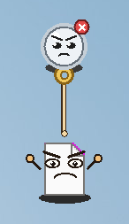
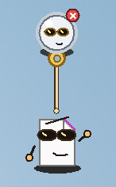
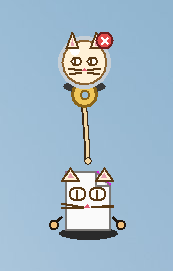

# FileNail

A nail that lives on the Windows desktop. Pull out a string, hook a file, and the file swings.

Hooked files are moved into FileNail's folder, not deleted. They come back on the nail after you restart the computer.

## Showcase

[Watch FileNail on the desktop](images/showcase.mp4): drag the nail, hook a file, and change how the character looks.

## Run it

Double-click `Start FileNail.vbs`.

If Python is already installed, FileNail starts immediately. If it is not, FileNail asks to download Python 3.15 from python.org and installs it for the current user. That step needs an internet connection. Python stays installed after FileNail closes.

Or, when Python is already installed, from this folder:

```bat
pyw -3 filenail.pyw
```

The first time it runs, it also adds itself to your Windows Startup folder, so the nail is there again after you sign in.

## Use it

- Drag the nail anywhere.
- Pull the gold ring and let go on a desktop icon to hook that file. You can also drop a file onto the nail.
- Drag the hanging icon toward the nail to shorten the string, or away from the nail to let more out. Scrolling on the icon does the same thing.
- Double-click the icon to open the file.
- Right-click the nail or a file for **Put the file back**, reel in, let out, and the rest.
- Right-click the nail and choose **Change look** to switch the face. The choice is remembered. See [Looks](#looks).
- Poke the nail. It blinks, and on a weekday it occasionally leaves a short note.
- Quit with the red X on the nail, or Ctrl+Shift+Q.

Shell items such as This PC cannot be moved. The FileNail folder itself cannot be hooked.

## Looks

Right-click the nail and choose **Change look**. The nail and the hanging file both change, and the choice is remembered.

| Goofy | Sleepy | Grumpy |
| :---: | :---: | :---: |
|  |  |  |

| Cool | Cat | Robot |
| :---: | :---: | :---: |
|  |  |  |

## Where files go

Held files and the saved nail position live in `%APPDATA%\FileNail`. **Put the file back** returns a file to the folder it came from.
